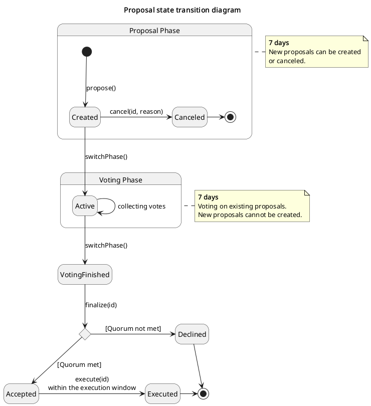

# DMD Diamond DAO

[DiamondDao](../../dao/contracts/DiamondDao.sol) manages proposal creation, voting, finalization, and execution. [DiamondDaoLowMajority](../../dao/contracts/DiamondDaoLowMajority.sol) checks quorum and executes open proposals that use a low majority.

## Proposal lifecycle

The DAO alternates between a seven-day proposal phase and a seven-day voting phase. `switchPhase` advances the phase once its deadline has passed.

1. A proposer submits a proposal during the proposal phase. The proposer can cancel it while its state is `Created`.
2. Uncanceled proposals become `Active` when the voting phase starts. Staking addresses of active or inactive pools can vote.
3. When the voting phase ends, the DAO snapshots the voters' pool stakes and the total staked amount. Proposals move to `VotingFinished`.
4. `finalize` counts the votes using the snapshot and marks the proposal `Accepted` or `Declined`.
5. An accepted proposal can be executed until the next voting phase ends and `switchPhase` is called. Only the proposer can execute a contract upgrade proposal.

## Quorum

A proposal needs at least one vote. It meets quorum when the stake voting Yes exceeds the stake voting No by at least the applicable share of the total stake recorded in the snapshot.

- **Low majority** requires one third of total stake for open low-majority proposals and ecosystem parameter changes.
- **High majority** requires one half of total stake for contract upgrades and open high-majority proposals.

For example, with 1,000,000 DMD staked, 600,000 DMD voting Yes and 100,000 DMD voting No meets both thresholds. With 350,000 DMD voting Yes and 250,000 DMD voting No, the 100,000 DMD margin falls short of both thresholds.

See the [quorum calculator](../../dao/contracts/library/QuorumCalculator.sol) and [quorum tests](../../dao/test/QuorumCalculator.spec.ts).
